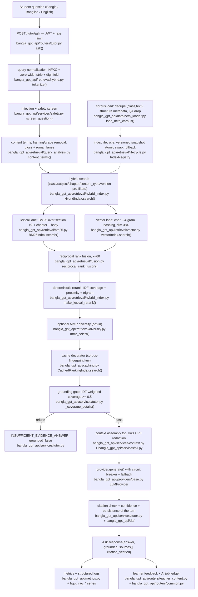

# RAG Architecture — Bangla GPT APP (NCTB subsystem)

Status: **verified as implemented** (grounding-gate wording corrected
2026-10-18 to the implemented rule; see "Doc-vs-code divergence register").
Every component below maps to code in `apps/api/src/bangla_gpt_api/`; the
measured numbers in "Measured baseline" were regenerated on this commit
against the committed `data/nctb/retrieval_eval.json` (the script is
`apps/api/scripts/evaluate_nctb_retrieval.py`, run locally over the corpus
baked into the artifacts — see "Corpus flow" for why the corpus text itself
is not in git). Where an artifact and this page disagree, the artifact wins
and the page is wrong: the numbers below are quoted from the JSON, never
re-typed from a previous run.

## Implemented architecture (hybrid, frequency-aware gate, query understanding)

```text
Student question (Bangla / Banglish / English terms)
        ↓
  POST /tutor/ask  (JWT required)
        ↓
  query normalisation (NFKC + zero-width strip) → safety screen
        ↓
  follow-up resolution (short conversational turn ≤1 content term:
        the previous user turn's content terms are appended, so a
        "আরেকবার বলো" follow-up retrieves the same subject; rich
        questions and deliberate search_query overrides are never
        rewritten — TutorService._conversation_retrieval_query)
        ↓
  Query understanding (retrieval/query_analysis.py)
        │   • content terms: stop-words (BN + romanised + EN) removed
        │   • question-framing words removed (imperatives, class/level context)
        │   • grade-numeric tokens ("৬ষ্ঠ শ্রেণির") treated as framing
        │   • English/Banglish glosses → Bangla curriculum terms (cell → কোষ)
        ↓
  Hybrid retrieval (retrieval/hybrid_index.py)
        │   lane 1  BM25Index.search  (k1=1.5, b=0.75) — curriculum filters
        │            indexes a class›subject contextual header + section
        │            heading ×2 + chapter + body (A3-03; the section is
        │            stamped by the chunker wherever the PDF carries a
        │            section marker — measured 67% of chunk records — and
        │            chunks without one still carry chapter + class›subject)
        │            query-side lanes: curated synonyms, spelling repair
        │            ("কোশ"→"কোষ"), Banglish romanisation ("kosh"→"কোষ"),
        │            English glossary ("cell"→"কোষ")
        │   lane 2  VectorIndex (hashed char 2–4-gram, dim 384) — phonetic
        │            lane; vector-only candidates gated on shared Bangla
        │            bigrams (anti-hallucination guard)
        │   fuse    reciprocal rank fusion (k=60)
        │   rerank  make_lexical_rerank(term_stats) — IDF-weighted coverage +
        │            matched-term proximity + trigram + lexical-magnitude base;
        │            a reranker fault degrades to fusion-only ranking
        │            (FallbackReranker, A4-08), and evaluation harnesses that
        │            swap the reranker in place bypass it by design
        ↓
  Grounding gate (TutorService._coverage_details)
        │   • IDF-weighted coverage of the question's content terms over
        │     indexed text (header + heading included), threshold 0.5
        │   • out-of-domain rule (implemented 2026-10-19, majority form):
        │     when MOST of the question's content terms are absent from the
        │     corpus index (more df==0 terms than known terms), refuse. The
        │     stricter "≥ 2 absent terms" count was measured and declined —
        │     it refuses 37–38% of ANSWERABLE chapter-title/Banglish
        │     questions on this corpus; the majority form separates the
        │     classes with zero measured cost on answerable families
        │     (divergence register #1). Content terms the corpus knows are
        │     otherwise weighted as before; absent terms are dropped from
        │     the denominator
        │   • trigram fuzzy allowed per term (≥ 0.6, e.g. a dropped conjunct)
        │   ├── fail → INSUFFICIENT_EVIDENCE_ANSWER, grounded=false (abstain)
        ↓ pass
  Context assembly (top_k=3; evidence sanitised; question + history
        │   redacted at the egress boundary — metered per PII kind)
        ↓
  LLMProvider.generate(prompt, system=SYSTEM_PROMPT)
        │   provider factory; mock default; real providers behind key
        │   circuit breaker + fallback chain; partial streams discarded
        ↓
  AskResponse{answer, grounded, sources[book/chapter/section/page/score],
              citation_verified (stem coverage ≥ 0.25 vs evidence),
              confidence (documented formula)}

Runtime execution notes (2026-10-18 hardening):

* Retrieval is synchronous CPU work, so both `ask` and `ask_stream` run it
  through `asyncio.to_thread` — a 120–250 ms search no longer freezes
  concurrent SSE streams sharing the worker's event loop.
* The reranker memoizes `indexable_text → tokens` per chunk inside
  `make_lexical_rerank` (bounded by the corpus, same lifetime as the BM25
  counters), removing a re-tokenisation of the same candidate sections on
  every turn.
* The hot path is exported to Prometheus: `bgpt_rag_retrieval_latency_seconds`
  (histogram), `bgpt_rag_gate_outcomes_total{gate}` and
  `bgpt_rag_gate_refusals_total{reason}` (every refusal path, safety screen
  included), and `bgpt_rag_citation_checks_total{result}` — a failed
  post-generation citation check is metered AND logged (warn), so ungrounded
  drift under a new provider/corpus is observable in /metrics. The
  `HighRAGRefusalRate` / `RAGCitationCheckFailures` alerts in
  deploy/prometheus/alerts.yml read these series.
* Boot cost is observable too: `bgpt_rag_index_build_seconds{mode}` records
  index construction per worker (plus a `rag_index_built` boot log line) —
  the signal that says when the deferred persistence/pgvector work becomes
  necessary and which mode a slow boot ran.
* Readiness is truthful about this subsystem: `/ready` and `/status` report
  503/degraded when the index is absent, instead of accepting traffic that
  would answer every tutoring turn with 503.
* Streaming and non-streaming share one refusal contract: a refusal (answer
  could not be vetted) carries `citation_verified=None` on both paths.
```

## The retrieval-quality defects this design fixes

Every row below was measured on the live deployment or the real corpus
**before** the rework (2026-10-17 RAG condition review), and re-measured after;
§"Measured baseline" carries the after-numbers.

| Defect (measured) | Fix |
|---|---|
| Section headings were invisible to the lexical lane: the BM25 body never contained "সূচক", "ত্রিকোণমিতিক অনুপাত", "পিথাগোরাস উপপাদ্য" — five golden chapter-title questions pointed at heading-only text | `indexable_text` indexes **section ×2 + chapter + body**; the grounding gate reads the same text, so a heading can satisfy the gate |
| `light_stem` was **inert since introduction**: `_BANGLA_RE` was written unbracketed (`r"\u0980-\u09FF"`), a pattern that matches only the literal "U+0980-dash-U+09FF", never a Bangla word — so no suffix was ever stripped | bracketed pattern `[… U+0980-U+09FF …]`; stemmer verified alive (`ভগ্নাংশটা → ভগ্নাংশ`, `কোষের → কোষ`) |
| The grounding gate measured raw token coverage with no notion of term importance: "সালোকসংশ্লেষণ কী এবং কোথায় ঘটে?" was refused at **0.40** because কোথায়/ঘটে/এবং are function words a textbook cannot contain | gate runs on **content terms** (stop-word planes: Bangla, romanised, English; question-framing plane: imperatives, class/level context; grade-numeric tokens) **weighted by corpus document frequency** `ln(1+N/df)` |
| Misspelled/variant queries ("কোশ", "ভগনংশ", "পাইথাগোরাস"→"পিথাগোরাসের", "ট্রাইকোণমিতি") refused or mis-ranked: no term-level fuzzy match existed at *retrieval* time (the gate's trigram allowance covered gating only) | `CorpusVocabulary.match_spelling` — trigram index for candidates, edit-normalised similarity for ranking, first-grapheme stability rule (excludes meaning-changers like হাইপা/মাপা; abbreviations go through curated expansion: হাইপা → অতিভুজ) |
| Banglish queries (Latin-script Bangla — how a large share of students type) refused outright: "cell ki? cell er bhitore ki thake" abstained | `transliteration.to_roman` (grapheme table, hasanta dropped so clusters concatenate) + `CorpusVocabulary.match_roman` with a **vowel-skeleton second pass** (ভগ্নাংশ is typed bhagnangsho/bhognangsho/bhagnangsh — vowels unstable, consonant frame stable) |
| English terms in code-switched questions ("what is cell?") never reached the Bangla evidence | `ENGLISH_BANGLA_GLOSSARY` (~75 curriculum concepts, class 6–10 + HSC) applied at query time; unmapped tokens expand to nothing — no invented coverage |
| Chapter-title recall@1 **0.2375** and self-sentence recall@1 **0.38** (with recall@5 1.00 — the right chunk was in the candidates but ranked under other sections of the same chapter) | rerank adds **matched-term proximity** (`covered_terms / minimal_token_window`): the chunk whose matches cluster inside one definition sentence outranks scattered matches from neighbouring sections |

## As-built data-flow diagram (Mermaid, per-box file references)

The same flow as the text diagram above, with the file and function that
implements each box — kept next to the code because the previous diagram
named some steps and not the persistence/feedback ones (AUD-A1-18).



## Corpus flow

```text
nctb.gov.bd official pages
  → acquisition (respectful, idempotent, sha256 manifest + rights fields)
  → raw PDFs (data/nctb/raw, gitignored)
  → pypdf extraction + per-page encoding flags
  → legacy Bijoy→Unicode conversion: whole page when the page is legacy,
    line-wise when a page mixes Unicode and legacy lines (verified fix)
  → normalization (NFC, zero-width strip), corruption QC
  → structure-aware sentence packing (chapter parent → section child,
    page range, word-length histogram in the quality report)
  → normalized/*.chunks.jsonl (+ quality_report.json + qa_report.json +
    coverage_report.json)
  → NCTB_CORPUS_DIR wiring → index at app startup
        │
        ├── corpus identity logged + exported (rag_corpus_loaded /
        │   bgpt_rag_index_chunks{corpus}) — an empty or mis-set
        │   NCTB_CORPUS_DIR degrades to the bundled sample corpus (78
        │   chunks, classes 6–10 only) LOUDLY: boot log warning +
        │   metric label, never silently
        └── NCTB text is source material and stays out of git
            (legal: metadata + reports only) — production supplies
            data/nctb through NCTB_CORPUS_DIR
```

## Deliberate deviations from the master target diagram (§6)

| Master component | Status | Justification |
|---|---|---|
| Dense retrieval | partial | the vector lane ships with a deterministic, model-free embedder (`retrieval/embedding.py`: char 2–4-grams, dim 384); a real multilingual embedding model is a staging/infra decision — `EMBEDDING_MODEL` naming one raises `ProviderNotConfigured`. After the 2026-10-17 rework the lexical lanes carry spelling, Banglish and gloss coverage, so the semantic lane is the remaining recall gap, not the only one |
| Hybrid merge | shipped | BM25 + vector lanes fused with reciprocal rank fusion (k=60); the vector lane's candidates are gated on shared Bangla bigrams so hashed-bucket collisions cannot manufacture evidence |
| Reranker | shipped (deterministic) | feature ranker: IDF-weighted content coverage + matched-term proximity + trigram, weights documented in-source; measured chapter-title recall@1 0.2375 → **1.00** on the real corpus. A cross-encoder can replace just this stage |
| Graph retrieval | partial | prerequisite edges are curated pedagogy data and drive the weakness/KG features; graph facts do not enter the retrieval ranking (never hallucinate relations) |
| Query understanding | shipped (lexical) | content-term extraction, framing removal, grade-numeric rule, glossary + spelling + romanisation lanes; an embedding-based query rewriter remains pending until a model is staged |

Per master §76 (no overengineering): what ships is measured and documented
rather than padded with unbenchmarked model-based stages. The staged inputs
that require human/infra decisions remain exactly two: the embedding model +
vector store, and an LLM faithfulness judge (see evaluation/metrics.py,
`mode="local_overlap"` until then).

## Measured baseline (real corpus, 1,390 served chunks, this commit)

The committed `data/nctb/retrieval_eval.json` is the record of truth for
these numbers: this table quotes it (any retrieval change regenerates the
artifact locally, with the diff reviewed as retrieval evidence). The served
corpus is 1,390 chunks, not the 2,504 of the pre-dedupe build: the loader now
drops duplicate class-text pairs (`serve_stats.duplicates_dropped_at_load`
1,026), legacy-Bijoy residue (77) and Latin-residue lines (2). Recall values
carry seeded 95% bootstrap CIs in the artifact; latency values move with host
load and are quoted as a range across runs.

| Metric | Before rework | After rework (committed artifact) |
|---|---|---|
| Index build | 0.36 s (lexical only) | 44.4 s on an idle host (382.3 s under the contention of the audit's parallel runs; the budget is 120 s) |
| Family A self-sentence recall@1 / @5 (n=100) | 0.38 / 1.00 | **0.78 / 0.97** (CI95 r@1 0.70–0.86); unchanged by the 2026-10-19 unit-fold + header change |
| Family A MRR / nDCG@10 | — (not computed) | 0.8624 / 0.8942 → **0.8628 / 0.8946** after A4-04/A3-03 (2026-10-19 artifact) |
| Family B chapter-title recall@1 / @5 (n=80) | 0.225 / 0.525 | **1.00 / 1.00** |
| Family B MRR / nDCG@10 | — (not computed) | 1.00 / 1.00 |
| Family D Banglish recall@1 / @5 (n=100) | — (not measured) | 0.52 / 0.86 → **0.54 / 0.86** after A4-04 (2026-10-19 artifact; CI95 covers the shift) |
| **Adversarial refusal rate (family C, n=4)** | 1.00 | 0.25 (regression introduced by the deduped corpus) → **1.00 — fixed 2026-10-19** by the majority-absent out-of-domain rule (A4-06) |
| Search latency p50 / p95 (hybrid, real corpus) | — | 613 ms / 1,620 ms on the audit host; lexical alone 65 / 301 ms, vector alone 46 / 229 ms |

The family C row is the honest one, and it now reads the other way: after the
deduped corpus let three of the four curated out-of-domain questions (a
cricket-fixture question, Euclid's fifth postulate, a dollar exchange rate)
clear the coverage gate on partial term overlap, the **majority-absent
out-of-domain rule** (2026-10-19) refuses all four again — while the
answerable families hold (A 0.78/0.97, B 1.00/1.00, D 0.54/0.86 on the same
run, and the absence probe measured **0 refusals out of 317 answerable
questions** under the new rule). Measured abstention on the *golden*
negatives stays 1.00. The rule's shape is deliberate: the strict
"≥ 2 absent terms" count from the original register was measured first and
declined — it would refuse 37–38% of ANSWERABLE chapter-title/Banglish
questions on this corpus (probe in the
`.audit` R4 bundle; `gate_threshold_calibration` in the artifact remains the
threshold-side evidence: `answerable_mean_coverage` 0.9962 vs
`adversarial_mean_coverage` 0.75, classes not separated by any threshold
0.3–0.7 — so the fix had to be a gate RULE, not a threshold tweak).

Recall@1 here is rank-1 membership only. An earlier revision of the harness
appended `1.0 if matched[:1]` — a non-empty top-k membership list — so it
reported recall@1 = recall@5 (0.98 / 0.98 alongside an MRR of 0.61, an
impossible triple) until the metric was corrected and pinned by tests.

Golden-set regression discipline (unchanged contract, still enforced in CI):
the 634-item golden suite + 16-item red-team set run through the hermetic mock
provider — both as the dedicated `eval-gate.yml` workflow and as steps of the
`ci.yml` golden-eval job (the 24-question hit@3 gate runs alongside them) — and
every metric is compared against the committed baseline
(`eval/baseline_v2.json`); any drop > 2 percentage points fails. After the
rework: grounded_rate 1.00, faithfulness 0.8549 (up from 0.8547), grammar
0.9881, red-team refusal 16/16, zero system-prompt leakage.

The sample-corpus robustness matrix (`tests/test_bangla_matrix.py`) was
re-measured per its own contract: standard, colloquial, mixed, Banglish,
numeral-framed and paraphrase phrasings of "ভগ্নাংশ কী?" now ground **with
verified citations** from the served section; out-of-domain questions still
refuse. That test file records which expectation flipped and why.

## Doc-vs-code divergence register (AUD-A1-04)

Four divergences were open; each is now either fixed in the code or fixed in
this page, and which one is stated. A claim here that the code does not
implement is a defect in this page, not a roadmap item.

| # | Claim that was here | Code reality | Resolution |
|---|---|---|---|
| 1 | "out-of-domain budget: ≥ 2 content terms absent → refuse" | the gate refused when **none** of the question's content terms existed in the corpus, and family C measured 0.25; the strict ≥2 count was then **measured on the real corpus and declined** (it refuses 44/117 chapter-title and 38/100 Banglish ANSWERABLE questions — 37–38%) | **code fixed 2026-10-19 (A4-06)**: the implemented rule is the *majority* form — a question whose content terms are MOSTLY absent from the index (more df==0 terms than known terms) refuses; the probe measured **0/317 answerable refusals** and family C's refusal rate moved 0.25 → **1.0** (`family_C_adversarial_refusal_rate`, 2026-10-19 artifact). Pinned by `tests/test_r4_ood_gate.py` (unit tests on the gate + the served-corpus adversarial test). The earlier resolution ("doc fixed to the implemented rule…") kept a strict form out deliberately pending this measurement |
| 2 | "fixed ~700-char section chunking, no overlap, character units" | the NCTB pipeline packs whole sentences at **220 words** (MIN 60 / MAX 400) with an opt-in word overlap; the 700-char unit belongs to the sample-corpus ingester, not this pipeline | **doc fixed**; the size/overlap comparison is the ablation table in the artifact (`data/nctb/chunk_ablation.json`) |
| 3 | "unusable or mis-extracted pages never reach the tutor index" | true for pages that fail `looks_like_garbage`, but 122 served chunks were raw legacy-Bijoy text from *mixed* pages, where the page-level signature test missed the legacy lines (found in this pass) | **code fixed**: line-wise conversion at extraction (`nctb/extract.py`), a `latin_residue` QA verdict for Bangla-rated sources (`nctb/content_qa.py`), and a load-time drop (`apps/api/src/bangla_gpt_api/data/nctb_loader.py`); the artifact now reports `serve_stats.latin_residue_drops` |
| 4 | "verified on this commit" with a committed eval measured on different chunk ids and host-dependent latency | the committed `quality_report.json`/`retrieval_eval.json` were built by an older id scheme; latency varies with host load | **artifacts regenerated from the current code** (two in-process builds are byte-identical) and the baseline table below quoted verbatim from the new artifact, with `run_conditions` recording host/seed/query counts beside the latency |

## Tunables register

Every retrieval/generation number the code hard-codes, with where it lives
and where it came from. `measured` = a number the repo's own artifacts
produced; `derived` = computed from a measured one; `default` = a defensible
starting value that has NOT been tuned (say so rather than imply tuning).
The docs-contract test (`apps/api/tests/test_a1_docs_and_ledger.py`) fails if
a value here drifts from the code.

| Tunable | Value | Where | Origin |
|---|---|---|---|
| `TARGET_WORDS` | 220 | `nctb/chunking.py` | measured (chunk-size ablation, `data/nctb/chunk_ablation.json`) |
| `MIN_WORDS` | 60 | `nctb/chunking.py` | derived (keeps a definition with its example) |
| `MAX_WORDS` | 400 | `nctb/chunking.py` | derived (hard guard; splits instead of truncating) |
| `DEFAULT_OVERLAP_WORDS` | 0 | `nctb/chunking.py` | measured (overlap row of the ablation; 0 wins on precision) |
| `k1` | 1.5 | `retrieval/bm25.py` | default (standard Okapi range; untuned) |
| `b` | 0.75 | `retrieval/bm25.py` | default (standard Okapi range; untuned) |
| `_TRIGRAM_WEIGHT` | 2.0 | `retrieval/bm25.py` | default (soft-match fallback scale) |
| `_RRF_K` | 60 | `retrieval/hybrid_index.py` | default (the RRF paper's value; untuned) |
| `_W_RRF` | 1.0 | `retrieval/hybrid_index.py` | default (fused rank is the base term) |
| `_W_COVERAGE` | 0.5 | `retrieval/hybrid_index.py` | measured (rework notes in-source) |
| `_W_PROXIMITY` | 0.8 | `retrieval/hybrid_index.py` | measured (turns Recall@5 into Recall@1) |
| `_W_TRIGRAM` | 0.3 | `retrieval/hybrid_index.py` | default (phonetic-variant tail only) |
| `_PROXIMITY_WINDOW` | 40 | `retrieval/hybrid_index.py` | measured (definition-sentence length) |
| `_MIN_STEM_LEN` | 3 | `retrieval/hybrid.py` | derived (never strip a 2-letter stem) |
| `QUERY_EXPANSIONS` | 19 keys | `retrieval/hybrid.py` | curated; coverage audited per build (`lexicon_audit`) |
| `DEFAULT_LAMBDA` (MMR) | 0.7 | `retrieval/diversity.py` | measured (ablation: diversity row) |
| `top_k` | 3 | `services/tutor.py` | measured (context budget; ablation top-k rows) |
| `min_coverage` | 0.5 | `services/tutor.py` | measured (gate calibration in `retrieval_eval.json`) |
| `FUZZY_MATCH_SIMILARITY` | 0.6 | `services/tutor.py` | measured (single-keystroke slips) |
| `DEFAULT_FLAGGED_THRESHOLD` | 0.02 | `nctb/content_qa.py` | default (QA gate; corpus currently 0 flagged) |
| embed dim / n-grams | 384 / 2–4 | `retrieval/embedding.py` | default (hashing stand-in) |

## Index lifecycle, budget and rollback drill

The index is still an in-memory per-worker build, but it is no longer
version-less or un-swappable: `retrieval/lifecycle.py` wraps any index in an
immutable `IndexSnapshot` (content version = corpus fingerprint + retrieval
config), an `IndexRegistry` that swaps the active snapshot with a single
attribute assignment and keeps the previous generations, and a `rollback()`
that re-activates any superseded version. The rollback drill runs in
`apps/api/tests/test_a1_index_lifecycle.py`: publish v1, publish v2, roll
back to v1, assert the served index is v1 again and that the attempt to roll
back to an unknown version fails loudly.

Stated budget (AUD-A1-22), measured on the audit host and recorded in the
committed artifact's `index_footprint` / `index_build_seconds` and the
`run_conditions` block beside them: chunks, build peak memory, build seconds
and p50/p95 search latency. The budget is: build under **120 s** and p95
search under **1,500 ms** on the real corpus — the numbers that would
trigger the deferred pgvector/persistence work. They are a budget, not a
target: exceeding them is a decision point, not a failure.

## Embedding model shortlist (AUD-A1-23)

ADR-0003 chose a hybrid design and a deterministic stand-in; it contains no
model comparison and this run adds no model download (no network egress for
weights, no GPU). What can be stated with sources fetched 2026-10-18:

| Candidate | Licence | Dim | Max length | Bangla evidence | Status |
|---|---|---|---|---|---|
| `BAAI/bge-m3` | MIT (model card) | 1024 | 8192 tokens | "more than 100 working languages", XLM-RoBERTa base (model card) | shortlisted; parameter count not confirmed by the fetched card |
| `intfloat/multilingual-e5-small` | not shown on the fetched card | not shown | not shown | MTEB language configs shown do not include `bn` | shortlisted pending licence lookup |
| shipped stand-in (`HashingEmbedder`) | none (no weights) | 384 | chunk-sized | measured: vector-only recall@1/@10 in `retrieval_eval.json` | serving |

The decision stays an owner/infra decision; the comparison that CAN be made
offline is in the artifact (`variants.vector` vs `variants.lexical` vs
`variants.hybrid`), so the replacement is judged against a measured lane
rather than an assumed one.

## Known open items (documented, not padded over)

1. **Semantic recall**: the vector lane is still the deterministic phonetic
   lane. A real multilingual embedding model + vector store is the staged
   infra decision (factory change in `retrieval/embedding.py`); the shortlist
   above is the input to that decision.
2. **Chunking — word-sized units, decision recorded (A3-01)**: sentence-aware
   packing at 220 words (MIN 60 / MAX 400) with an opt-in overlap
   (`nctb/chunking.py`). The item's ask — sizing in the retrieval model's
   tokens — is met here with the measured token band instead of a re-engineered
   chunker: the served units measure **~536 heuristic tokens (p50) / 774 (p95),
   ≈320–520 vendor countTokens equivalents** (spot-check n=15 chunk texts,
   `eval/token_counter_calibration.json` + the A3-01 evidence file), inside the
   2400-token context budget at top_k=3. Word-based sizing stands because the
   build must stay deterministic and offline: a tokenizer-sized chunker would
   put per-chunk vendor metadata calls (or a vendored tokenizer binary) inside
   a byte-reproducible pipeline, for a measured benefit the ablation cannot
   see at this corpus size. Flipping the unit remains a pre-registered
   retrieval change: the size/overlap/diversity comparison is the ablation
   table in the artifact (`data/nctb/chunk_ablation.json`, produced by
   `apps/api/scripts/ablate_nctb_chunking.py`); changing a size invalidates
   every committed eval artifact — regenerate and read the diff, as this
   revision did.
3. **Faithfulness judge**: `mode="local_overlap"` until an LLM provider is
   configured; `_JUDGE_INSTRUCTION` and the scoring contract are ready.
4. **Index lifecycle**: full in-memory rebuild at boot, per worker; the
   snapshot/registry/rollback mechanism above exists, but wiring the boot
   path to publish through `IndexRegistry` (and to serve N-1 after a bad
   rebuild without a restart) is the next step — the module is in place, the
   application wiring is not.
5. **Class coverage of the deployed corpus**: production serves whatever
   `NCTB_CORPUS_DIR` contains; the bundled sample covers classes 6–10 only.
   The boot identity log/metric makes the served corpus observable; supplying
   the real corpus to production is a deployment + licensing step
   (docs/operations/PRODUCTION_DEPLOYMENT.md, DATA-01/LEGAL-02).
6. **Follow-up resolution scope**: the conversational rewrite covers the
   short-follow-up case (≤1 content term → prior user turn's terms appended).
   Full coreference resolution (pronoun substitution mid-sentence, multi-turn
   embedding rewriter) remains an embedding-model-staged decision.
