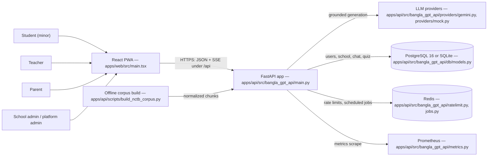
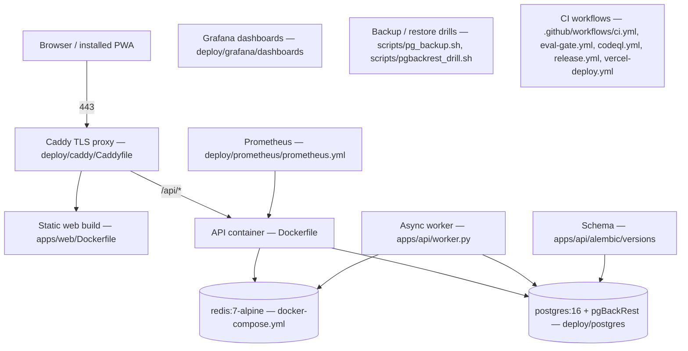
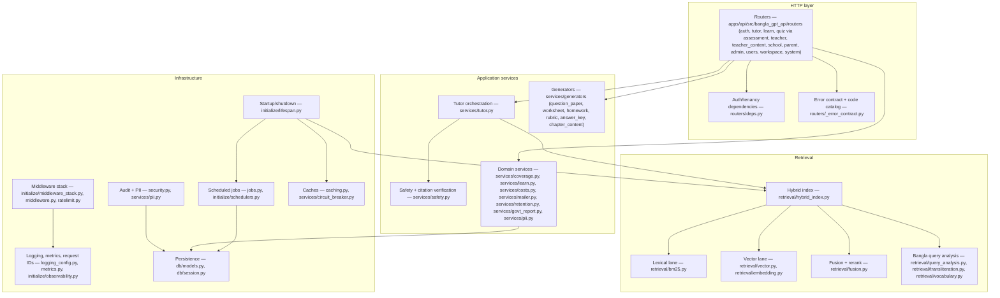

# Architecture — Bangla GPT APP

> Status: Phase 8 (web dashboard & production hardening). This document
> records **actual, verified** decisions only. Pending items are explicitly marked.

## Goal

NCTB-grounded, Bangla-first AI personal tutor platform for Bangladesh:
students get a safe curriculum-aligned tutor; teachers get an AI assistant;
parents/admins get oversight. Full requirement baseline lives in the project
master plan (REQ-001..REQ-035+).

## Verified environment constraints (2026-08-25)

| Toolchain | Present | Decision |
|---|---|---|
| Python 3.12.10 | yes | Backend language |
| Node 24 / npm 11 | yes | Frontend toolchain for the `apps/web` dashboard (Vite + React + TypeScript) |
| Docker | yes | Containerized (Dockerfile + docker-compose.yml); CI builds and smoke-tests the image |
| Flutter SDK | no | Mobile deferred (cannot verify locally) |
| LLM API keys | no | Not provided; provider abstraction + deterministic mock |

## Stack decisions (Phase 1)

- **Backend:** Python 3.11+/FastAPI, pydantic-settings. Rationale: dominant
  ecosystem for RAG/LLM tooling; verifiable on this machine.
- **Layout:** monorepo. `apps/api` first; `apps/web`, `apps/mobile` reserved.
- **Config:** env-driven (`Settings`), `.env.example` documents variables;
  real `.env` is gitignored.
- **LLM access:** `LLMProvider` protocol + factory. `mock` is the default and
  is fully tested. Real providers (e.g., Gemini/OpenAI) are added ONLY when a
  key is supplied by the user; unknown values fail loudly (`503` on `/ready`).
- **Testing:** pytest + FastAPI TestClient; CI runs the suite on Python
  3.11 and 3.12.

## Repository layout

```text
BanglaGptApp/
├── apps/api/                 # FastAPI service
│   ├── src/bangla_gpt_api/   # config, main, routers/, services/, retrieval/, nctb/
│   └── tests/
├── apps/web/                 # React dashboard (Vite + TS) + Capacitor Android
├── deploy/                   # caddy / postgres / prometheus / grafana configs
├── scripts/                  # ops & maintenance scripts
├── .github/workflows/        # ci.yml, eval-gate.yml, release.yml, vercel-deploy.yml
├── docker-compose.yml
├── Dockerfile
└── docs/                     # living documentation (see docs/README.md)
```

## Stack decisions (Phase 2 — student domain core, verified)

- **Curriculum model** (`curriculum/models.py`): `CurriculumMeta` carries the
  full provenance set required by the master plan (`curriculum_year`,
  `class_level`, `subject`, `book`, `chapter`, `section`, `page`, `language`,
  `source`, `version`, `content_type`). Every retrieval chunk keeps its
  metadata; versions never mix because filters key on them.
- **Ingestion** (`ingestion/text_ingester.py`): deterministic marker-based
  ingester for structured plain text (chapter/section/paragraph). PDF/OCR
  adapters pending corpus arrival.
- **Retrieval** (`retrieval/hybrid_index.py`; default `RETRIEVAL_MODE=hybrid`):
  BM25 (`retrieval/bm25.py`, dependency-free Okapi BM25 with curriculum-aware
  filtering) + a deterministic vector lane, fused by RRF and lexically
  reranked. A Bangla-block tokenizer (U+0980-U+09FF) is
  required — `\w+` splits on Bangla vowel signs/virama and destroys words
  (verified bug, fixed, regression-tested).
- **Tutor service** (`services/tutor.py`): retrieve → grounding gate →
  provider generate → cited answer. Below-threshold retrieval returns an
  explicit insufficient-evidence refusal instead of inventing content
  (hallucination guard, master §32).
- **Sample corpus** (`data/sample_nctb/`): ORIGINAL synthetic Bangla text for
  pipeline verification only — NOT real NCTB content.

## Verified behaviors (Phase 2)

- `/tutor/ask` grounded path returns cited sources (book/chapter/section).
- Out-of-curriculum questions refuse with `grounded=false`.
- Payload validation (question length, class range) returns 422.
- Unconfigured providers: `/ready` and `/tutor/ask` return 503 loudly.

## Stack decisions (Phase 3 — quizzes & progress, verified)

- **Persistence** (`db/`): SQLAlchemy 2.0 (`students`, `quiz_attempts`,
  `answer_log`). SQLite default (in-memory for tests; file URL via
  `DATABASE_URL`). Alembic migrations are checked in (`alembic/versions/`) and
  CI runs upgrade → downgrade → upgrade plus `alembic check`; `create_all`
  remains only for in-memory test databases.
- **Quiz engine** (`services/quiz.py`): deterministic cloze generator over
  curriculum chunks (rare-term blanking, seeded distractor sampling). This is
  an honest baseline — an LLM-backed generator with a validation gate replaces
  it later; generated questions are never marked trusted without validation.
- **Answer safety**: quiz payloads never contain answer keys; grading happens
  server-side; double-submit and length-mismatch rejected.
- **Progress** (`/students/{id}/progress`): per-chapter accuracy computed from
  answer logs; chapters under 60% flagged as weak.
- **DI style**: FastAPI `Annotated` dependencies; ruff kept enabled.

## Verified behaviors (Phase 3)

- Deterministic generation (same seed ⇒ same quiz), valid 4-option MCQs.
- No answer leakage in `/quizzes` response (asserted on raw JSON).
- Grading integrity: review rows reconcile exactly with stored score.
- Student validation, unknown student/attempt → 404/422 paths.

## Stack decisions (Phase 4 — auth & teacher analytics, verified)

- **Credentials**: Argon2id at the OWASP parameters (`time_cost=2`,
  `memory_cost=19 MiB`, `parallelism=1`) via the `argon2-cffi` dependency
  (`auth/security.py`). Legacy PBKDF2-HMAC-SHA256 hashes are still verified for
  existing accounts and re-hashed to Argon2id on the next successful login.
- **Tokens**: HS256 JWT (`pyjwt`), `sub`=user id, `role`, `exp`
  (`JWT_EXPIRE_MINUTES`). Secret from env (`JWT_SECRET`); the committed dev
  default is documented as insecure-on-purpose in `.env.example`.
- **Authorization**: role gates (`student`, `teacher`; admin roles pending) +
  object-level ownership checks — students can only read/submit their own
  data; teachers have class-wide read access and may generate quizzes for
  students. Cross-student access returns 403 (regression-tested).
- **Teacher API**: roster with per-student attempt/average stats; class-level
  chapter analytics with weak-chapter (<60% accuracy) identification.
- Legacy unauthenticated `POST /students` was removed; profiles are now
  created through `/auth/register` only.

## Verified behaviors (Phase 4)

- Register/login round-trips; duplicate email → 409; bad email/short
  password/missing class_level → 422; wrong credentials → generic 401
  (no user enumeration).
- Missing/garbage/forged-secret/expired tokens all rejected with 401;
  student token on teacher endpoints → 403.
- Cross-student isolation enforced on profile, progress, quiz start/submit.

## Stack decisions (Phase 5 — RBAC completion & hardening & container, verified)

- **Admin role**: never self-registered (`/auth/register` Literal rejects it).
  Bootstrap admin is created at startup only when `ADMIN_EMAIL` +
  `ADMIN_PASSWORD` are set and no admin exists. Admin endpoints: list users,
  change roles (with last-admin demotion guard → 409), platform overview
  counts.
- **Rate limiting** (`RateLimitMiddleware`): IP and per-user scopes over the
  configured rule set (`RATE_LIMIT_RULES` / `_derive_default_rules`: login,
  MFA challenge, tutor, teacher AI generators, …); limits via settings;
  returns 429. Window type depends on the backend (`ratelimit.py`): the
  default in-process `memory` backend is a sliding 60 s window, while the
  shared `redis` backend (`RATE_LIMIT_BACKEND=redis`, the multi-worker/
  production setting) uses fixed 60 s `INCR`/`EXPIRE` counters.
- **Body-size guard**: requests with `Content-Length` above `MAX_BODY_BYTES`
  (default 4,000,000 bytes, see `config.py`) rejected 413 before routing.
- **Container** (`Dockerfile`): python:3.12-slim, non-root user, healthcheck,
  package install from source. Verified by CI job that builds the image,
  boots it, and asserts `/health` + `/ready` over HTTP.

## Stack decisions (Phase 6 — observability, migrations, evaluation harness, verified)

- **Logging**: `logging_config` (JSON lines via stdlib) + `RequestIdMiddleware`
  that echoes/creates `X-Request-ID` on every response. The `ready` probe now
  checks database reachability in addition to the LLM provider.
- **Migrations**: Alembic (initial revision `7a826704cc96`) checked in;
  `upgrade head → downgrade base → upgrade head` verified locally and in CI.
  Runtime still calls `create_all` for the in-memory test databases —
  Alembic is authoritative for any file/persistent database.
- **Evaluation harness**: `evaluation/runner.py` (`EvalQuestion` /
  `evaluate_questions`) scores grounding correctness over a curated JSON set
  (`eval/sample_questions.json`, 10 items: 5 in-domain true, 5 out true →
  hallucination-guard). The sample file proves 100% accuracy on the current
  mock tutor; a real LLM key swaps in without changing the harness.

## Stack decisions (Phase 7 — parent dashboard, verified)

- **Parent linkage**: `parents` + `parent_student_links` (unique per pair)
  tables; `/parents/link` (parent role), `/parents/me/children` and
  `/parents/me/children/{id}/progress` scoped by explicit link. Tests assert
  linkage, duplicate 409, unknown 404, and cross-parent isolation (403
  vs 404 as appropriate).
- **Role set** now `student | teacher | parent | admin`; registration
  enforces `class_level` only for students; `RoleUpdateRequest` covers all
  four. `AdminOverview` now reports `parents` count.

## Stack decisions (Phase 8 — web dashboard & production hardening, verified)

- **Authenticated tutor**: `/tutor/ask` now requires a valid JWT (`CurrentUser`);
  unauthenticated requests get 401 with `WWW-Authenticate: Bearer`. This closes
  the planned migration item from the Phase 7 risk table.
- **Self-service profile API**: `GET /users/me` returns the caller's user +
  role-profile mapping (needed by any frontend to discover `profile_id`);
  `DELETE /users/me` implements GDPR-style deletion — removes profile rows,
  quiz attempts + answer logs, and parent-student links in one transaction;
  the last remaining admin is protected with 409.
- **Metrics**: Prometheus instrumentation via a dedicated registry
  (`metrics.py`): `bgpt_http_requests_total{method,path,status}`,
  `bgpt_http_request_duration_seconds` histogram, and an unhandled-exception
  counter. Exposed at `GET /metrics`; route templates are used as labels
  (no raw-path cardinality). `prometheus-client` added as runtime dependency.
- **Web dashboard** (`apps/web`, Vite + React + TypeScript): login/register,
  student tutor-quiz-progress, teacher roster/analytics, parent linkage +
  scoped progress, admin users/role management/overview. JWT stored in
  localStorage; role resolved server-side via `/users/me`. Dev proxy maps
  `/api/*` → API; production base URL overridable via `VITE_API_BASE`.
  CI builds it with Node 24 (`tsc && vite build`).
- **CI hardening**: mypy and pip-audit are now required steps of the api job
  (previously local-only), plus the new web build job.
- **In-memory SQLite fix**: bare `sqlite://` URLs now also use StaticPool
  (same connection shared) — previously only URLs containing `:memory:` did,
  which broke registration on default test settings.

## Verified behaviors (Phase 8)

- Unauthenticated `/tutor/ask` → 401; authenticated grounded/refused paths unchanged.
- `GET /users/me` returns correct profile for all four roles.
- Student self-deletion removes account + attempts + logs + parent links
  (parent's children list becomes empty); login afterwards → 401.
- Last admin cannot delete self (409); second admin can.
- `/metrics` exposes request/latency series after traffic.
- `apps/web` type-checked production build passes on Node 24.

## Stack decisions (Phase 9 — NCTB RAG subsystem, verified)

- **Acquisition**: official nctb.gov.bd listing pages inventoried (16
  secondary + 32 HSC artifacts); respectful idempotent downloader with
  sha256 provenance manifest; copyrighted content gitignored, provenance
  committed. The published artifacts are the national curriculum documents
  (জাতীয় শিক্ষাক্রম), not student e-books — textbook PDFs are not exposed
  by the site and remain a data gap.
- **Encoding**: all verified PDFs use legacy Bijoy/SutonnyMJ ANSI encoding;
  `nctb/bijoy.py` converts to Unicode (verified on real pages) with
  per-page crash isolation and honest QC (`quality_report.json`).
- **Indexing safety**: only pages whose extracted text passes the corruption
  heuristic are chunked (`nctb/extract.py` `PageText.usable` →
  `nctb/chunking.py`), so un- or mis-converted pages never reach the tutor
  index. Class level is derived only when unambiguous, else the declared
  level range applies.
- **Grounding gate**: query-term coverage ≥ 0.5 replaces absolute score
  floors that measurably fail to transfer between corpus scales;
  adversarial refusal 4/4 on the real corpus.
- **Evaluation harness**: `apps/api/scripts/evaluate_nctb_retrieval.py` measures
  Recall@K over self-sentence and chapter-title families plus adversarial
  refusal, writing `data/nctb/retrieval_eval.json`.

## As-built architecture (C4 + RAG data flow)

> Added 2026-10-18 (C-01/AUD-CD-01). Everything above is the phase-by-phase
> build log; this section is the *as-built* view derived from the code, and it
> is the one to read first. Every box names a file that exists in this
> repository; a box that names a directory means every module under it.
> Existence was checked with a scripted scan of this section
> (C-01 verification, recorded in the audit evidence bundle). C4 level 2 and 3
> are Mermaid, so GitHub renders them inline.

### Level 1 — System context



### Level 2 — Containers (docker-compose.yml)



### Level 3 — API components



### RAG as-built data flow

Offline ingestion (left) and the online query path (right); the pipeline is
versioned by the corpus manifest written next to the chunks.

```mermaid
flowchart LR
  subgraph offline["Offline: build (apps/api/scripts/build_nctb_corpus.py)"]
    src["Source registry — nctb/sources.py, nctb/acquisition.py"] --> ext["PDF text extraction — nctb/extract.py, pypdf"]
    ext --> bijoy["Legacy Bijoy to Unicode — nctb/bijoy.py"]
    bijoy --> norm["NFC + zero-width normalization — nctb/normalize.py"]
    norm --> chunk["Structure-aware chunking — nctb/chunking.py"]
    chunk --> qa["Content QA gate — nctb/content_qa.py"]
    qa --> manifest["Checksum manifest — nctb/manifest.py"]
    qa --> jsonl["normalized/*.chunks.jsonl — data/nctb"]
  end
  subgraph online["Online: answer"]
    req["POST /tutor/ask + /tutor/ask/stream — routers/tutor.py"] --> ctxbuild["Assistant context — services/context.py"]
    ctxbuild --> qanalyze["Query analysis — retrieval/query_analysis.py"]
    qanalyze --> load["Chunk load — data/nctb_loader.py, nctb/corpus.py"]
    load --> hybrid["Hybrid retrieve — retrieval/hybrid_index.py"]
    hybrid --> cov["Coverage / insufficiency gate — services/tutor.py, services/coverage.py"]
    cov -->|"below threshold"| refuse["Explicit refusal payload — services/safety.py"]
    cov -->|"grounded"| prompt["Prompt assembly — services/tutor.py"]
    prompt --> provider["Provider call — providers/base.py, providers/mock.py or providers/gemini.py"]
    provider --> verify["Citation + confidence check — services/safety.py verify_citation"]
    verify --> sse["SSE token stream — routers/tutor.py StreamingResponse"]
    sse --> persist["History persisted — db/models.py Conversation/ChatMessage"]
    persist --> events["Metrics + audit — metrics.py, security.py write_audit"]
  end
  jsonl --> load
  manifest --> load
```



### Error contract (C-06)

The HTTP error surface is declared in one place:
`apps/api/src/bangla_gpt_api/routers/_error_contract.py`. Three shapes exist on
the wire and are frozen as-is:

1. `{"detail": "<message>"}` — auth guards and single-message failures
   (`MessageDetail`).
2. `{"detail": {"code": ..., "message": ..., <declared extras>}}` — business
   rules (`CodedDetail`); every `code` must be a row in `ERROR_CATALOG` with
   its status and exact key set. `review_required` is the one legacy body
   without a `message` key; its key set is recorded rather than "fixed".
3. `{"detail": [{"loc": [...], "msg": ...}]}` — FastAPI's validation shape,
   reproduced at exactly one site (`FRAMEWORK_VALIDATION_SITES`).

`apps/api/tests/test_cd_error_contract.py` scans the source with `ast` and
fails when a raised code is missing from the catalog, when a status or key set
drifts, or when a fourth shape appears. Adding a code means adding one
`ErrorSpec` row in the same commit.

## Module design review and the complexity ratchet (C-05 / C-03)

The audit found 20 files over 500 lines in the two `src` trees (worst 1464)
and 67 functions at radon rank C or worse (11 at D or worse), with no gate and
no review behind the backlog. The ratchet's baseline now records 29 files over
500 lines across src, tests, scripts and the web app. This is the review, module by module, plus the enforcement that stops
the backlog growing while the refactors land.

| Module (current lines) | Worst functions (radon CC) | Decision |
|---|---|---|
| `schemas.py` (1464) | request/response models, worst `AnswerKeyIn` (7) | Keep one file for now: it is a flat catalogue with no logic; complexity is not the problem, volume is. Split by domain only when a schema change forces a merge conflict — tracked, not scheduled. |
| `routers/school.py` (1060) | `school_health_overview` (26), `school_students` (16) | Refactor candidate #2: the health overview aggregates five queries in one function. Deferred to a dedicated change (needs school-scoped fixtures); frozen by the ratchet meanwhile. |
| `services/tutor.py` (1039) | `_coverage_details` (26), `ask_stream` (25) | Refactor candidate #1 after `export_me`: `ask_stream` is the streaming path — it needs a failure-injection test first. Frozen by the ratchet meanwhile. |
| `routers/users.py` (906) | `post_consent_reconfirm` (12) | **Refactored in this pass**: `export_me` was F(43) and is now A(2), split into `_export_identity_sections`, `_export_chat_sections`, `_export_user_tables`, `_export_teacher_tables`, `_export_plan_and_invite_tables`, `_export_credential_tables`, `_export_account_tables`, `_export_student_learning` (all rank ≤ B(9)). Behaviour unchanged; the export test suite stayed green. The file grew 835 → 906 lines because the extraction adds signatures and docstrings — the size baseline records that deliberately. |
| `routers/teacher_content.py` (960) | `teacher_qp_replace` (30), `teacher_qp_review` (17) | Refactor candidate #3: both are question-paper review flows; extract a transition helper. Frozen by the ratchet meanwhile. |
| `routers/assessment.py` (837) | `teacher_curriculum_coverage` (22) | Refactor candidate #4 (same shape as `school_health_overview`). Frozen. |
| `routers/learn.py` (828) | `_build_dashboard_summary` (28), `global_search` (21) | Refactor candidate #5: dashboard summary is five independent aggregates; split when the student dashboard tests are extended. Frozen. |
| `db/models.py` (811) | none above B (declarative models) | No action: size is column declarations, not logic. |
| `routers/tutor.py` (813) | `send_chat_message` (14) | Watch: the streaming route belongs to the same refactor as `ask_stream`; no split before that. Frozen. |
| `routers/common.py` (700) | `_generate_document` (23) | Refactor candidate #6: one function dispatches four generators; extract the per-kind branches. Frozen. |

Frontend files over 500 lines — `apps/web/src/i18n.ts` (1370),
`apps/web/src/api.ts` (1114), `apps/web/src/pages/student/AITutorPage.tsx`
(1044), `apps/web/src/pages/student/LearnPage.tsx` (1044) — are covered by the
file-size gate but not by the complexity gate: ESLint complexity rules for
TypeScript are part of the CI backlog, and view code is better judged by render
cost than by cyclomatic count.

### The ratchet

`apps/api/scripts/check_quality_ratchet.py` freezes today's violations in
`apps/api/quality-baselines/` and fails on **new** ones:

| Gate | Tool | Baseline | Fails when |
|---|---|---|---|
| `complexity` | radon | `complexity-baseline.json` | a function reaches rank C (CC ≥ 11) that is not recorded, or a recorded one grows |
| `file-size` | stdlib | `file_size-baseline.json` | a file over 500 lines is not recorded, or a recorded one grows |
| `dead-code` | vulture (`--min-confidence 80`) | `vulture_whitelist.py` | vulture reports a symbol the whitelist does not account for |
| `deps` | deptry | `deps-baseline.json` | a new DEP001/DEP002/DEP003 finding appears |
| `duplication` | jscpd (`--min-lines 6 --min-tokens 70`) | `duplication-baseline.json` | a duplicate block appears that was not in the baseline |

Run it with the project's environment:

```bash
cd apps/api
python scripts/check_quality_ratchet.py --check            # all gates
python scripts/check_quality_ratchet.py --check complexity  # one gate
python scripts/check_quality_ratchet.py --report           # current state only
```

Improvements need no baseline edit: a violation that no longer exists, or one
that shrank, simply stops being reported. Adding a violation, or growing one,
requires fixing it — or a deliberate `--update` in the same commit with the
justification in the commit message. The tooling (radon, vulture, deptry, and
`npx jscpd`) must be present; each gate exits 2 when its tool is missing rather
than passing silently.

## Pending (explicitly NOT built yet)

| Item | Blocker |
|---|---|
| Live Gemini latency/quota validation | a real `GEMINI_API_KEY` must be deployed (the provider integration and its contract tests ship) |
| Student পাঠ্যপুস্তক (textbook) corpus | not published as static downloads on nctb.gov.bd static pages; needs alternate authorized channel/OCR pipeline |
| Model-based dense retrieval + model-based reranker benchmark | embedding-model benchmark infrastructure (a dependency-free vector lane and RRF fusion already ship; the golden set + 2pp gate run in CI) |
| Mobile release builds (Capacitor Android signing, iOS) | no JDK/Android SDK or macOS host on the dev machine (the project ships at `apps/web/android`) |
| Sustained scale beyond the CI rehearsal | Postgres/Redis profiles, monitoring/alerts and backups ship (see `docs/runbook.md` §2/§5, `docs/backup_dr.md`); load numbers come from local probes, not a production soak |
