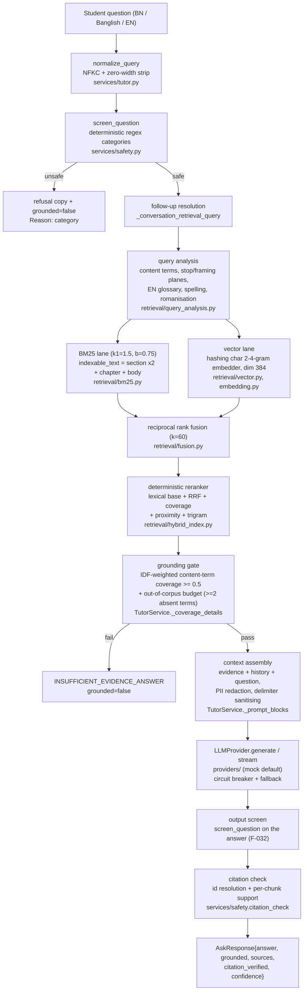

# RAG architecture — current state (verified against code, 2026-10-29)

This is the **as-built** map of the retrieval-augmented answering subsystem,
written from the code on `qa/enterprise-v2-hardening` (base SHA
`7e8525e2ff0eea31dcf8e9c93f189a010e2eff5c`) and the measurements recorded in
`.qa-work/audit/RAG/report.md`. Where a claim cannot be verified offline
(live-model behaviour), it is marked so.

`docs/RAG_ARCHITECTURE.md` is the earlier written architecture; its
"Corrections (2026-10-29)" section lists where it drifted from the code.
`docs/rag/target-architecture.md` is the gap analysis and P0–P3 roadmap.

## 1. Pipeline as built



## 2. Stage-by-stage (module + config)

| Stage | Implementation | Config / store | Notes |
|---|---|---|---|
| Ingestion (NCTB) | `nctb/acquisition.py` (urllib GET, sha256 manifest, politeness delay), `nctb/extract.py` (pypdf), `nctb/bijoy.py` (legacy-font conversion) | `data/nctb/raw`, `extracted/*.pages.json`, `manifests/acquisition_manifest.jsonl` | Corpus text is gitignored (licence); the committed record is `data/nctb/retrieval_eval.json` |
| Ingestion (uploads) | none into the index; the OCR adapter is permission-gated and unwired (`ingestion/ocr_ingester.py`) | `BGPT_OCR_CONFIRMED` gate | Uploaded/text material does not reach the served index today |
| Normalisation | ingest `nctb/normalize.normalize_bangla` (NFC, zero-width strip, whitespace); query `services/tutor.normalize_query` (NFKC, zero-width strip); tokenizer `retrieval/hybrid.tokenize` (NFKC) | — | Two different Unicode forms by design; no offset map back to the PDF |
| Chunking | `nctb/chunking.py`: structure-aware, chapter parent -> section child, word budget 220 target / 60 min / 400 max, dedupe by normalised-text hash | `normalized/<source>.chunks.jsonl` | Character counts are not used; sizes are words, not model tokens |
| Class attribution | `data/nctb_loader.resolve_class_targets`: (1) book-level cover statement via `nctb/normalize.detect_class_levels`, (2) declared level range (`LEVEL_CLASS_RANGE`) when `multi_class_fallback=True`, (3) refuse | `quality_report.json` per-source `level`/`subject_bn` | Never invents a class; refused and level-derived sources are logged |
| Indexing | in-memory per worker at boot: `BM25Index` + `VectorIndex` + `CorpusVocabulary`; `CachedRankingIndex` wraps it when caching is on | `retrieval_mode` (`hybrid` default), `embedding_model` (empty = hashing embedder), `nctb_corpus_dir` | Metrics `bgpt_rag_index_build_seconds{mode}`, `bgpt_rag_index_chunks{corpus}`; boot identity log `rag_corpus_loaded` |
| Query understanding | `retrieval/query_analysis.py` (content terms, stop-word planes BN/roman/EN, framing plane, grade-numeric rule, EN->BN glossary), `retrieval/vocabulary.py` (spelling repair, Banglish roman lane) | pure functions | Deterministic, no model, no language ID |
| Retrieval | BM25 lane + hashed-vector lane in parallel; candidate pool = 3 x top_k; class/subject/chapter pre-filters inside `search` | `top_k=3` in the tutor | Vector lane candidates are gated on shared Bangla bigrams |
| Fusion / rerank | RRF (k=60) then deterministic feature reranker (lexical magnitude + RRF + weighted coverage + matched-term proximity + trigram) | constants in source (`retrieval/fusion.py`, `retrieval/hybrid_index.py`) | No cross-encoder, no MMR, no parent expansion |
| Grounding gate | `TutorService._coverage_details`: IDF-weighted content-term coverage >= `min_coverage` (0.5) over the best chunk, trigram fuzzy allowance per term, and the out-of-corpus budget `OUT_OF_CORPUS_ABSENT_BUDGET = 2` | threshold constants in `services/tutor.py` | Gate reads `indexable_text` (heading included); counters `bgpt_rag_gate_outcomes_total`, `bgpt_rag_gate_refusals_total{reason}` |
| Context assembly | `TutorService._prompt_blocks` + `build_evidence_prompt`: `<evidence>` blocks, history block, `<user_question>`; optional `<attached_image>` declaration on vision turns; PII redaction; delimiter sanitising | no token budget; `top_k=3` | Injection rule set lives in `SYSTEM_PROMPT` (7 rules + image rule 8) |
| Generation | `LLMProvider.generate/stream`; route/size intent routing (`services/router.py`); circuit breaker + fallback (`services/circuit_breaker.py`) | `llm_provider` (mock default), provider keys, `llm_max_output_tokens` | Streaming and buffered paths share the refusal contract |
| Output screen | `TutorService._answer_trips_screen` on the composed answer (and on the accumulated stream buffer before each delta) | reuses `services/safety.screen_question` | Refusal reason `output_screen`, metered on `bgpt_rag_gate_refusals_total` |
| Citation check | `services/safety.citation_check`: citation-marker resolution against the retrieved set + per-chunk sentence support | `_SENTENCE_SUPPORT_THRESHOLD = 0.6` | Warn-level policy: verdict surfaced as `citation_verified`, metered on `bgpt_rag_citation_checks_total` |
| Refusal policy | safety screen -> coverage gate -> output screen -> model-refusal marker (`_MODEL_REFUSAL_MARKER`) | — | Every refusal returns `grounded=false` with a `refused_reason` label |
| Logging / metrics | `tutor_retrieval`, `ai_call`, `ai_call_stream` JSON lines with `request_id` correlation; Prometheus counters/histograms; admin AI-quality board (`routers/admin.py`) | `deploy/prometheus/alerts.yml` | No per-answer trace store |

## 3. Corpus flow

```text
nctb.gov.bd listing pages
  -> nctb/acquisition.py (sha256 manifest, politeness delay)
  -> data/nctb/raw (gitignored)
  -> nctb/extract.py (pypdf) + nctb/bijoy.py (legacy conversion)
  -> nctb/normalize.normalize_bangla (NFC, zero-width strip)
  -> nctb/chunking.chunk_pages (chapter -> section, word budget)
  -> data/nctb/normalized/*.chunks.jsonl + quality_report.json
  -> data/nctb_loader.load_nctb_corpus  (class attribution ladder, injection strip)
  -> initialize/dependencies.build_dependencies (index at boot per worker)
```

`NCTB_CORPUS_DIR` selects the corpus; an empty or misconfigured directory
degrades to the bundled synthetic sample **loudly** (boot warning, corpus
label on `bgpt_rag_index_chunks`, and a production boot refusal for the
unset-directory case in `main._validate_corpus`).

## 4. Measured behaviour (this tree, commands recorded)

| Measurement | Command | Result |
|---|---|---|
| Family A self-sentence recall@1 / @5 (n=100) | `python scripts/evaluate_nctb_retrieval.py <corpus copy>` | 0.98 / 0.98, MRR 0.6512 |
| Family B chapter-title recall@1 / @5 (n=80) | same | 0.675 / 0.95, MRR 0.8052 (was 1.275 — impossible — before the F-048 fix) |
| Family C adversarial refusal (4 questions) | same | 1.00 (was 0.25 before the F-002 gate fix) |
| Out-of-corpus false-answer rate (4 family-C probes) | `.qa-work/evidence/E-FIX-002-1/gate_measure.py --corpus <copy>` | 0/4 (was 3/4, Wilson 95% [0.30, 0.95]) |
| In-corpus false-refusal rate (624 golden answerable items) | `gate_measure.py --sample` | 5/624 (pre-existing, unchanged by the budget) |
| Retrieval hit@3 over golden chapter expectations (624 items) | `python -m bangla_gpt_api.evaluation.cli --gate` | 1.0000 (floor 0.95) |
| Golden v2 regression (634 items, mock) | `python -m bangla_gpt_api.evaluation.cli` | gate PASS vs `eval/baseline_v2.json` |
| Red-team suite (23 items, mock) | `python -m bangla_gpt_api.evaluation.cli --redteam` | PASS, no leak |

Search latency and index build time are machine-dependent (measured
p50 261 ms / p95 367 ms and a 44 s build on the 2,599-chunk corpus build used
for these runs); the committed `data/nctb/retrieval_eval.json` is an older,
smaller build (2,508 chunks) and is not reproducible from the current raw
files — see `docs/rag/target-architecture.md` P1.

## 5. Known limits (as built, not aspirations)

* The vector lane is a deterministic hashing embedder, not a semantic model.
* No token budget or truncation in context assembly; `top_k=3` fixed.
* No offset map from chunks back to PDF text; ingest NFC vs query NFKC.
* Class attribution for the five secondary curriculum documents is
  level-scoped (their covers are legacy-font garbled), which the loader logs
  as `level-range`; chapter metadata is absent on most of those chunks.
* The citation verdict is surfaced and metered but does not yet discard or
  regenerate an unsupported answer.
* Retrieval has no timeout/retry/fallback isolation, and `/tutor/ask`
  degrades to 503 (not retrieval-only) when the provider is unavailable.
