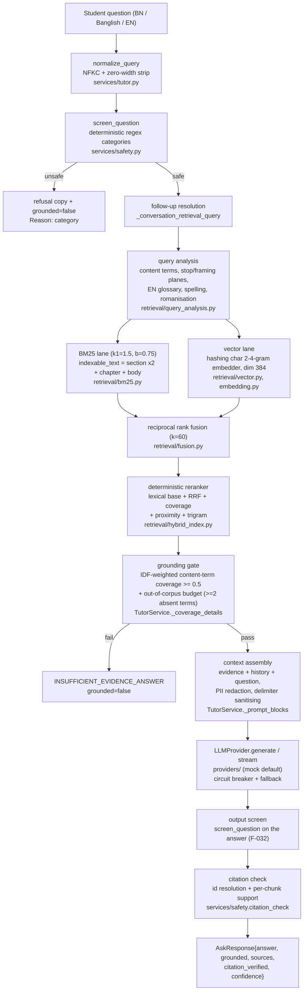

# RAG architecture — current state (verified against code, 2026-10-29)

This is the **as-built** map of the retrieval-augmented answering subsystem,
written from the code on `qa/enterprise-v2-hardening` (base SHA
`7e8525e2ff0eea31dcf8e9c93f189a010e2eff5c`) and the measurements recorded in
`.qa-work/audit/RAG/report.md`. Where a claim cannot be verified offline
(live-model behaviour), it is marked so.

`docs/RAG_ARCHITECTURE.md` is the earlier written architecture; its
"Corrections (2026-10-29)" section lists where it drifted from the code.
`docs/rag/target-architecture.md` is the gap analysis and P0–P3 roadmap.

## 1. Pipeline as built



## 2. Stage-by-stage (module + config)

| Stage | Implementation | Config / store | Notes |
|---|---|---|---|
| Ingestion (NCTB) | `nctb/acquisition.py` (urllib GET, sha256 manifest, politeness delay), `nctb/extract.py` (pypdf), `nctb/bijoy.py` (legacy-font conversion) | `data/nctb/raw`, `extracted/*.pages.json`, `manifests/acquisition_manifest.jsonl` | Corpus text is gitignored (licence); the committed record is `data/nctb/retrieval_eval.json` |
| Ingestion (uploads) | none into the index; the OCR adapter is permission-gated and unwired (`ingestion/ocr_ingester.py`) | `BGPT_OCR_CONFIRMED` gate | Uploaded/text material does not reach the served index today |
| Normalisation | ingest `nctb/normalize.normalize_bangla` (NFC, zero-width strip, whitespace); query `services/tutor.normalize_query` (NFKC, zero-width strip); tokenizer `retrieval/hybrid.tokenize` (NFKC) | — | Two different Unicode forms by design; no offset map back to the PDF |
| Chunking | `nctb/chunking.py`: structure-aware, chapter parent -> section child, word budget 220 target / 60 min / 400 max, dedupe by normalised-text hash | `normalized/<source>.chunks.jsonl` | Character counts are not used; sizes are words, not model tokens |
| Class attribution | `data/nctb_loader.resolve_class_targets`: (1) book-level cover statement via `nctb/normalize.detect_class_levels`, (2) declared level range (`LEVEL_CLASS_RANGE`) when `multi_class_fallback=True`, (3) refuse | `quality_report.json` per-source `level`/`subject_bn` | Never invents a class; refused and level-derived sources are logged |
| Indexing | in-memory per worker at boot: `BM25Index` + `VectorIndex` + `CorpusVocabulary`; `CachedRankingIndex` wraps it when caching is on | `retrieval_mode` (`hybrid` default), `embedding_model` (empty = hashing embedder), `nctb_corpus_dir` | Metrics `bgpt_rag_index_build_seconds{mode}`, `bgpt_rag_index_chunks{corpus}`; boot identity log `rag_corpus_loaded` |
| Query understanding | `retrieval/query_analysis.py` (content terms, stop-word planes BN/roman/EN, framing plane, grade-numeric rule, EN->BN glossary), `retrieval/vocabulary.py` (spelling repair, Banglish roman lane) | pure functions | Deterministic, no model, no language ID |
| Retrieval | BM25 lane + hashed-vector lane in parallel; candidate pool = 3 x top_k; class/subject/chapter pre-filters inside `search` | `top_k=3` in the tutor | Vector lane candidates are gated on shared Bangla bigrams |
| Fusion / rerank | RRF (k=60) then deterministic feature reranker (lexical magnitude + RRF + weighted coverage + matched-term proximity + trigram) | constants in source (`retrieval/fusion.py`, `retrieval/hybrid_index.py`) | No cross-encoder, no MMR, no parent expansion |
| Grounding gate | `TutorService._coverage_details`: IDF-weighted content-term coverage >= `min_coverage` (0.5) over the best chunk, trigram fuzzy allowance per term, and the out-of-corpus budget `OUT_OF_CORPUS_ABSENT_BUDGET = 2` | threshold constants in `services/tutor.py` | Gate reads `indexable_text` (heading included); counters `bgpt_rag_gate_outcomes_total`, `bgpt_rag_gate_refusals_total{reason}` |
| Context assembly | `TutorService._prompt_blocks` + `build_evidence_prompt`: `<evidence>` blocks, history block, `<user_question>`; optional `<attached_image>` declaration on vision turns; PII redaction; delimiter sanitising | no token budget; `top_k=3` | Injection rule set lives in `SYSTEM_PROMPT` (7 rules + image rule 8) |
| Generation | `LLMProvider.generate/stream`; route/size intent routing (`services/router.py`); circuit breaker + fallback (`services/circuit_breaker.py`) | `llm_provider` (mock default), provider keys, `llm_max_output_tokens` | Streaming and buffered paths share the refusal contract |
| Output screen | `TutorService._answer_trips_screen` on the composed answer (and on the accumulated stream buffer before each delta) | reuses `services/safety.screen_question` | Refusal reason `output_screen`, metered on `bgpt_rag_gate_refusals_total` |
| Citation check | `services/safety.citation_check`: citation-marker resolution against the retrieved set + per-chunk sentence support | `_SENTENCE_SUPPORT_THRESHOLD = 0.6` | Warn-level policy: verdict surfaced as `citation_verified`, metered on `bgpt_rag_citation_checks_total` |
| Refusal policy | safety screen -> coverage gate -> output screen -> model-refusal marker (`_MODEL_REFUSAL_MARKER`) | — | Every refusal returns `grounded=false` with a `refused_reason` label |
| Logging / metrics | `tutor_retrieval`, `ai_call`, `ai_call_stream` JSON lines with `request_id` correlation; Prometheus counters/histograms; admin AI-quality board (`routers/admin.py`) | `deploy/prometheus/alerts.yml` | No per-answer trace store |

## 3. Corpus flow

```text
nctb.gov.bd listing pages
  -> nctb/acquisition.py (sha256 manifest, politeness delay)
  -> data/nctb/raw (gitignored)
  -> nctb/extract.py (pypdf) + nctb/bijoy.py (legacy conversion)
  -> nctb/normalize.normalize_bangla (NFC, zero-width strip)
  -> nctb/chunking.chunk_pages (chapter -> section, word budget)
  -> data/nctb/normalized/*.chunks.jsonl + quality_report.json
  -> data/nctb_loader.load_nctb_corpus  (class attribution ladder, injection strip)
  -> initialize/dependencies.build_dependencies (index at boot per worker)
```

`NCTB_CORPUS_DIR` selects the corpus; an empty or misconfigured directory
degrades to the bundled synthetic sample **loudly** (boot warning, corpus
label on `bgpt_rag_index_chunks`, and a production boot refusal for the
unset-directory case in `main._validate_corpus`).

## 4. Measured behaviour (this tree, commands recorded)

| Measurement | Command | Result |
|---|---|---|
| Family A self-sentence recall@1 / @5 (n=100) | `python scripts/evaluate_nctb_retrieval.py <corpus copy>` | 0.98 / 0.98, MRR 0.6512 |
| Family B chapter-title recall@1 / @5 (n=80) | same | 0.675 / 0.95, MRR 0.8052 (was 1.275 — impossible — before the F-048 fix) |
| Family C adversarial refusal (4 questions) | same | 1.00 (was 0.25 before the F-002 gate fix) |
| Out-of-corpus false-answer rate (4 family-C probes) | `.qa-work/evidence/E-FIX-002-1/gate_measure.py --corpus <copy>` | 0/4 (was 3/4, Wilson 95% [0.30, 0.95]) |
| In-corpus false-refusal rate (624 golden answerable items) | `gate_measure.py --sample` | 5/624 (pre-existing, unchanged by the budget) |
| Retrieval hit@3 over golden chapter expectations (624 items) | `python -m bangla_gpt_api.evaluation.cli --gate` | 1.0000 (floor 0.95) |
| Golden v2 regression (634 items, mock) | `python -m bangla_gpt_api.evaluation.cli` | gate PASS vs `eval/baseline_v2.json` |
| Red-team suite (23 items, mock) | `python -m bangla_gpt_api.evaluation.cli --redteam` | PASS, no leak |

Search latency and index build time are machine-dependent (measured on the
2,599-chunk corpus build used for these runs: p50 261-293 ms, p95 367-495 ms
and a 44 s build across the verification runs); the committed
`data/nctb/retrieval_eval.json` is an older,
smaller build (2,508 chunks) and is not reproducible from the current raw
files — see `docs/rag/target-architecture.md` P1.

## 5. Known limits (as built, not aspirations)

* The vector lane is a deterministic hashing embedder, not a semantic model.
* No token budget or truncation in context assembly; `top_k=3` fixed.
* No offset map from chunks back to PDF text; ingest NFC vs query NFKC.
* Class attribution for the five secondary curriculum documents is
  level-scoped (their covers are legacy-font garbled), which the loader logs
  as `level-range`; chapter metadata is absent on most of those chunks.
* The citation verdict is surfaced and metered but does not yet discard or
  regenerate an unsupported answer.
* Retrieval has no timeout/retry/fallback isolation, and `/tutor/ask`
  degrades to 503 (not retrieval-only) when the provider is unavailable.

## 6. Generation and validation (wave-2 additions)

Appended by the wave-2 generation/observability stream; sections 1-5 above are
the retrieval stream's map and are unchanged. Everything here is as built on
this branch and labelled where it is a proposal or unverified.

### 6.1 Prompt identity (RAG-13)

`services/tutor.py` owns the tutor system prompt as a versioned artifact:
`PROMPT_VERSION` (`tutor-prompt-v1`) and `PROMPT_SHA256` (SHA-256 of the
template). Both are emitted on every `ai_call` and `ai_call_stream` log line
and on every per-answer trace, and the *composed* prompt (evidence + history +
question) is hashed per answer as well. A wording change is a version bump: the
hash then changes by itself and answers recorded under the old revision stay
explicable. The extraction probes in `tests/test_w2_llm_prompt_extraction.py`
assert that no answer carries a 24-character window of the prompt, including
for extraction attempts appended to legitimate questions, which is stricter
than the red-team suite's 40-character marker.

### 6.2 Per-answer trace (RAG-29)

`evaluation/observability.py` holds `AnswerTrace` / `AnswerTraceStore` and the
process-wide `TRACE_STORE` the tutor writes to (capacity 500, in-process, never
copied to the database). One trace per answer records: the question's SHA-256
fingerprint (NFKC + whitespace squashed, truncated), whether a follow-up
rewrite fired and by how many terms, the retrieved chunk ids and scores (none
for refusals that never retrieved), the prompt version and both prompt hashes,
the model, the parameters (`top_k`, `min_coverage`, route, `prompt_chars`), the
citation verdict (`verified` or `unverified:<reason>`), the outcome
(`answered`, `safety_refusal`, `insufficient_evidence`, `model_refused`,
`outage`) and the per-stage latency. **No student text of any kind is stored**
-- the fingerprint cannot be reversed and the chunks are ids, not text.

`AnswerTraceStore.aggregate()` returns what a board should read: retained and
total counts, grounded/refusal rates, outcomes, models, citation verdicts and
p50/p95/p99 per stage; it contains nothing per-answer. The API surface that
should serve it (`GET /admin/ai/quality` in `routers/admin.py`) is outside this
stream's file ownership and is recorded as a handoff in the stream report,
together with the exact three-line patch.

### 6.3 Per-stage latency and targets (RAG-26)

New histograms on the existing Prometheus registry
(`evaluation/observability.py`, exported by `/metrics`):
`bgpt_rag_stage_latency_seconds{stage}` with the fixed stage set
(`rewrite`, `retrieval`, `gate`, `generate`, `ttft`, `total`) and
`bgpt_generation_overload_total{stage}`. Labels carry no user, question, model
or tenant value, so cardinality is bounded by construction.

Measured on this tree with `python -m bangla_gpt_api.evaluation.cli
--latency-report` (mock provider, bundled 78-chunk sample corpus, 120 positive
golden items, 40 streaming samples; milliseconds):

| stage | n | p50 | p95 | p99 |
|---|---|---|---|---|
| rewrite | 160 | 0.0 | 0.0 | 0.0 |
| retrieval (tutor, threaded) | 160 | 10.0 | 107.4 | 161.6 |
| lexical lane | 120 | 2.9 | 71.7 | 101.5 |
| vector lane | 120 | 1.4 | 2.6 | 11.0 |
| rerank | 120 | 4.4 | 12.5 | 36.4 |
| gate | 160 | 2.0 | 38.1 | 57.1 |
| time to first token | 34 | 0.0 | 0.0 | 0.0 |
| generation (mock) | 125 | 0.0 | 8.0 | 10.8 |
| total | 160 | 15.0 | 130.5 | 273.7 |

A second run of the same command on the same machine (also in evidence)
measured retrieval p50 14.0 / p95 159.3 / p99 293.2 ms and total p50 19.0 /
p95 206.1 / p99 314.6 ms, i.e. this desktop under concurrent agent load varies
by roughly 1.5x between runs. Quote the shape (retrieval dominates, rerank and
gate are small, rewrite is sub-millisecond), not the third digit; regenerate
the table with the command above on the deployment hardware before treating
any number as an SLO input.

Proposed targets, derived from these numbers and the audit's 2,599-chunk
measurements (retrieval p95 367-495 ms there) -- targets, not measurements:

| stage | target | basis |
|---|---|---|
| rewrite | p95 <= 5 ms | measured p95 < 1 ms; pure CPU, no model |
| retrieval (search incl. rerank) | p95 <= 800 ms at <= 3,000 chunks | measured p95 107 ms at 78 chunks; 495 ms at 2,599 chunks |
| rerank | p95 <= 150 ms | measured p95 12.5 ms; scales with candidate set |
| gate | p95 <= 150 ms | measured p95 38 ms |
| time to first token | p95 <= 2,500 ms (live provider) | UNVERIFIED-LIVE: the mock yields instantly; the worker timeout is 60 s |
| total (non-stream) | p95 <= 3,000 ms at <= 3,000 chunks | measured p95 131 ms + live generation budget |

Index capacity row to add to `docs/capacity_plan.md` (owned by the docs
stream; recorded here as the stream's proposal):

> | RAG index (per worker) | in-memory BM25 + hashed-vector over the served corpus; 78 sample chunks build in ~1 s and serve p95 107 ms; 2,599 NCTB chunks build in 44-59 s and serve p95 367-495 ms; ~0.5-2 KB RAM per chunk (text + postings + 384-dim vector) | rebuild per worker at boot, no shared store; scale by corpus size, not concurrency | `bgpt_rag_index_build_seconds`, `bgpt_rag_index_chunks`, `bgpt_rag_stage_latency_seconds{stage="retrieval"}` |

### 6.4 Language integrity (RAG-21)

`evaluation/metrics.py` now computes two deterministic answer-side legs on
every grounded answer: Bengali script share (Bengali-block vs Latin characters)
and the count of Assamese letters U+09F0/U+09F1. `language_verdict()` marks a
Bangla-script question answered with a mostly non-Bangla reply as inconsistent,
and the suite aggregates `language_consistency` plus
`assamese_letter_violations`; both are printed by the eval CLI, which also
labels the judge legs (`faithfulness` in `llm_judge` mode, reference
correctness, register) as **UNVERIFIED-LIVE** whenever the deterministic
overlap mode runs. Measured on the committed golden v3 set under the mock:
language_consistency 1.0000, zero Assamese letters.

### 6.5 Structured-output validation (LLM-07)

`evaluation/output_validation.py` implements the semantic layer the generator
parsers lacked: unique options and exactly one correct option per item, counts
against the request (worksheet tiers, question-paper difficulty plan, rubric
criteria, lesson-plan sections), marks arithmetic, and an exact
fraction-based recomputation of arithmetic answer keys from the question text
(`ast`-parsed, never `eval`). It returns violation lists rather than raising,
so a caller can log the whole set. The call sites are in
`services/generators/**`, which this stream does not own: the wiring (one call
per generator after parsing, before persistence) is a handoff recorded in the
stream report.

### 6.6 Degraded modes (RAG-28, F-117, F-031)

* **Retrieval failure**: `TutorService._retrieve_guarded` isolates the hybrid
  pipeline. If the fused search raises, the lexical lane serves the turn
  (`bgpt_rag_retrieval_degraded_total{stage="lexical_fallback"}`); if no lane
  can serve it, the hit list is empty, the gate refuses, and generation is
  never reached -- a partial retrieval failure cannot produce an uncited answer
  marked grounded. Covered by `tests/test_w2_llm_retrieval_fallback.py`.
* **Generation concurrency**: a per-process semaphore
  (`MAX_CONCURRENT_GENERATIONS = 8`, held across the fallback attempt and for
  the whole stream) with a bounded wait
  (`GENERATION_QUEUE_TIMEOUT_SECONDS = 5`). A turn that cannot get a slot
  refuses with its own envelope (`refused_reason="ai_busy"`, counted on
  `bgpt_generation_overload_total`). Slots are released on success, provider
  failure and client disconnect.
* **Provider outage / operator kill switch**: unchanged from sections 1-5
  (circuit breaker + fallback provider; `AI_GENERATION_ENABLED=false` answers
  the generation surfaces with the disabled envelope while reading, search and
  quizzes keep working). LLM-down mode still returns 503 rather than
  retrieval-only excerpts -- that remains open (F-131) and is an owner-visible
  gap, not a claim.

### 6.7 Confidence display (LLM-10)

`services/safety.answer_confidence` blends source breadth and mean retrieval
score into a 0-1 value; it is a **heuristic signal, not a calibrated
probability**, and no calibration against answer correctness exists. The label
required in the UI copy (both languages) and in the API documentation is
"retrieval confidence (heuristic)" / "সোর্স-নিশ্চয়তা (আনুমানিক)", with the
percentage rendered against that label, never as a bare "x% confident". The UI
strings live in `apps/web/src` (i18n) and the response-field description in
`apps/api/src/bangla_gpt_api/schemas*.py`; neither file belongs to this stream,
so both edits are handoffs recorded in the stream report with the exact strings.

### 6.8 Evaluation set

The committed set, its construction, composition, dev/test split and leakage
rules are documented in `docs/rag/golden-set-v3.md`; the runnable integrity
gate is `python -m bangla_gpt_api.evaluation.cli --check-golden` (part of
`--gate`).

